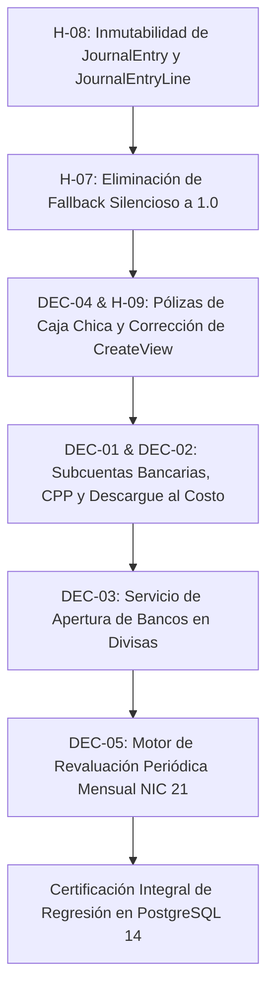

# VECTOR ERP — FASE 1C.8.2
# INFORME DE EVALUACIÓN DE IMPACTO TÉCNICO Y PREPARACIÓN CONTROLADA DE CORRECCIONES

**Documento de Diagnóstico Técnico, Auditoría de Código Fuente y Planificación de Correcciones**
**Proyecto:** VECTOR ERP
**Base de Referencia:** Commit `023247e05c9959572d9881eae8d77eb8aedc92d6`
**Worktree de Integración:** `/Users/kevinmejia/Documents/ERP VECTOR/.worktrees/main-integration`
**Rama:** `main`
**Roles:** Principal Financial Systems Architect, Senior Django Financial Systems Engineer, QA Lead y Revisor Técnico-Contable Independiente
**Estado:** Inspección técnica y preparación exclusivamente. No modifica código fuente, base de datos ni Git. No declara políticas contables aprobadas.

---

## 1. ESTADO DEL ENTORNO Y COMMIT VERIFICADO

Se ejecutó la inspección obligatoria de solo lectura previa a la auditoría técnica:

- **Ruta absoluta del worktree de integración:** `/Users/kevinmejia/Documents/ERP VECTOR/.worktrees/main-integration`
- **Rama activa:** `main`
- **Commit HEAD verificado:** `023247e05c9959572d9881eae8d77eb8aedc92d6` (`fix(finance): enforce bank ledger and currency integrity`)
- **Estado de Git (`git status --short`):**
  ```text
  ?? informe_impacto_tecnico_fase1c8_2.md
  ```
  *(Se registra de forma transparente la presencia del presente entregable documental generado en el worktree; ningún archivo de código fuente, configuración, prueba o migración ha sido alterado).*
- **Diferencias frente al commit esperado:** 0 diferencias. El HEAD verificado coincide exactamente con el commit de referencia `023247e`.
- **Workspace Principal:** `/Users/kevinmejia/Documents/ERP VECTOR` en rama `integration/candidate-phase1` (HEAD `741d426b5d349afc4ef6125d7b6c651fdee63b5d`), completamente limpio e intacto.
- **Informes contables previos preservados íntegros:**
  1. `matriz_decisiones_contables_fase1c8_1.md`
  2. `informe_validacion_matematica_contable_fase1c8_1_1.md`
  3. `informe_correcciones_fase1c8_1_2.md`
  4. `informe_auditoria_adversarial_fase1c8_1_3.md`
  5. `informe_correccion_documental_fase1c8_1_4.md`
  6. `informe_revision_independiente_fase1c8_1_5.md`
- **Entorno de ejecución:**
  - Python: `3.13.5`
  - Django: `4.2.7`
  - Configuración de Base de Datos (`config/settings.py:101-107`): Motor bimodal vía `dj_database_url.config(default="sqlite:///{BASE_DIR / 'db.sqlite3'}")`.
  - Servidor PostgreSQL: Local en `/tmp:5432`, base de datos aislada `test_erp_sas` operativa y validada.
- **Riesgos de ejecutar pruebas con la configuración local por defecto:**
  - El motor SQLite aplica bloqueos a nivel de archivo/tabla completa durante transacciones. Al ejecutar pruebas multihilo con `select_for_update()` (ej. `test_14_concurrency_control_on_debt_settlement`), SQLite arroja `OperationalError: database table is locked` en lugar de aislar el bloqueo a nivel de fila como lo hace PostgreSQL 14 (motor de producción).

---

## 2. RESUMEN EJECUTIVO

Este informe constituye el **puente técnico obligatorio entre la auditoría documental previa (Fases 1C.8.1 a 1C.8.1.5) y la futura fase de implementación controlada**.

A través del rastreo exhaustivo y directo del código fuente real, se constata que:
1. **La distorsión cambiaria en pagos a proveedores (DEC-01) es un hecho real en el código:** `record_supplier_payment_journal_entry` acredita Bancos Institucionales a tasa spot (`settlement_rate`), desvinculando la salida del banco de su costo contable en libros y sobregirando potencialmente el Mayor General en córdobas aunque el saldo en dólares sea cero.
2. **Ausencia de Submayor Multimoneda y CPP (DEC-02):** El modelo `BankAccount` opera como un auxiliar monomoneda en divisa nativa; no almacena valor contable en córdobas (`carrying_value_nio`) ni tasa promedio ponderada.
3. **Omisión de Asientos en Caja Chica (DEC-04):** `allocate_petty_cash_fund` y `disburse_petty_cash_replenishment` mueven saldos físicos y emiten `FinancialTransaction`, pero **no generan ninguna póliza contable en el Libro Diario**. Asimismo, el catálogo base carece de una cuenta oficial para Fondos Fijos de Caja Chica.
4. **Bug Crítico en Vista de Caja Chica:** `PettyCashFundCreateView` asigna directamente `current_balance = allocated_amount` en base de datos; si luego se procesa la dotación bancaria, el saldo disponible se duplica.
5. **Inexistencia de Motor de Revaluación Periódica (DEC-05):** No existe ningún servicio o comando en el repositorio que ejecute revaluación contable al cierre de período bajo NIC 21.
6. **Vulnerabilidades de Inmutabilidad Contable (H-08):** `JournalEntry` y `JournalEntryLine` carecen de bloqueos en `delete()` y `save()`, y poseen `on_delete=CASCADE`, permitiendo la eliminación física en cascada de asientos contables.
7. **Riesgo en Validación Cambiaria (H-07):** Existe un fallback silencioso a `1.0` en egresos en USD si la tasa no es provista, y se carece de validación de bandas de tolerancia frente al BCN.

---

## 3. INVENTARIO DE COMPONENTES INSPECCIONADOS

```text
========================================================================================================================
INVENTARIO DE ARCHIVOS Y COMPONENTES AUDITADOS EN EL REPOSITORIO
========================================================================================================================
MÓDULO        ARCHIVO                             LÍNEAS AUDITADAS        COMPONENTES CLAVE RASTREADOS
------------------------------------------------------------------------------------------------------------------------
Finance       apps/finance/models.py              L11–L82                 Modelo BankAccount (campos, saldo nativo).
              apps/finance/models.py              L84–L145                Modelo PettyCashFund (fondo asignado, saldo).
              apps/finance/models.py              L500–L525               FinancialTransaction (inmutabilidad delete).
              apps/finance/models.py              L526–L574               AccountingAccount (catálogo, cuentas NIIF).
              apps/finance/models.py              L575–L756               JournalEntry (pólizas, verify_and_save_balance).
              apps/finance/models.py              L758–L800               JournalEntryLine (débitos, créditos, CASCADE).
              apps/finance/services.py            L16–L61                 allocate_petty_cash_fund (kardex caja chica).
              apps/finance/services.py            L64–L145                record_petty_cash_expense (gasto operativo).
              apps/finance/services.py            L148–L183               submit_petty_cash_replenishment (solicitud).
              apps/finance/services.py            L185–L245               disburse_petty_cash_replenishment (reposición).
              apps/finance/services.py            L247–L286               ensure_default_chart_of_accounts (catálogo).
              apps/finance/services.py            L518–L645               record_supplier_payment_journal_entry (pago prov).
              apps/finance/services.py            L840–L965               Cobranzas a clientes y póliza COLLECTIONS.
              apps/finance/views.py               L126–L144               BankAccountCreateView (alta de banco saldo cero).
              apps/finance/views.py               L146–L165               PettyCashFundCreateView (inicialización caja).

Purchasing    apps/purchasing/services.py         L158–L479               record_supplier_disbursement (cadena de pago).
              apps/purchasing/models.py           L380–L440               SupplierPayment (campos de divisa y egreso).

Billing       apps/billing/services.py            L480–L575               execute_pos_sale y cobros de facturas.
              apps/billing/services_cash.py       L275–L510               prepare_cash_bank_deposit / confirm_deposit.

Core          apps/core/models.py                 L120–L160               CountryConfig (tasas oficiales de cambio).
========================================================================================================================
```

---

## 4. EVIDENCIA DEL COMPORTAMIENTO REAL EN EL CÓDIGO (DEC-01 A DEC-05)

### DEC-01 — Pagos a Proveedores en USD y Valuación del Banco

#### 1. Rastreo de la Cadena de Invocación
- **Punto de Entrada:** La vista o servicio de compras invoca a `record_supplier_disbursement` ([apps/purchasing/services.py:158](file:///Users/kevinmejia/Documents/ERP%20VECTOR/.worktrees/main-integration/apps/purchasing/services.py#L158)).
- **Validación Bancaria:** En líneas 307–310 se valida `locked_bank.currency == curr`. Si el pago es en USD, la cuenta bancaria de salida debe ser en USD.
- **Creación de Egreso:** En líneas 368–382 se crea `SupplierPayment` con `amount_in_payment_currency=amt`, `currency_paid=curr`, `exchange_rate_applied=tc`.
- **Invocación Contable:** En línea 431 se invoca atómicamente a `record_supplier_payment_journal_entry` ([apps/finance/services.py:518](file:///Users/kevinmejia/Documents/ERP%20VECTOR/.worktrees/main-integration/apps/finance/services.py#L518)).

#### 2. Cita Textual de Líneas Reales en `apps/finance/services.py`
```python
# apps/finance/services.py: líneas 561-572
561:    # 2. Determinar el desembolso real en NIO (Bancos / Caja)
562:    settlement_rate = supplier_payment.exchange_rate_applied or Decimal('1.0')
563:    if supplier_payment.currency_paid == 'USD':
564:        disbursement_nio = (supplier_payment.amount_in_payment_currency * settlement_rate).quantize(Decimal('0.01'), rounding=ROUND_HALF_UP)
565:    elif supplier_payment.currency_paid == 'NIO':
566:        disbursement_nio = supplier_payment.amount_in_payment_currency.quantize(Decimal('0.01'), rounding=ROUND_HALF_UP)
567:    else:
568:        disbursement_nio = (supplier_payment.amount_in_payment_currency * settlement_rate).quantize(Decimal('0.01'), rounding=ROUND_HALF_UP)
569:
570:    # 3. Determinar diferencial cambiario
571:    fx_diff = disbursement_nio - cxp_nio
...
# apps/finance/services.py: líneas 633-641
633:            # 3. HABER: Bancos Institucionales o Caja por el desembolso real
634:            JournalEntryLine.objects.create(
635:                organization=organization,
636:                entry=entry,
637:                account=cash_or_bank_account,
638:                concept=credit_concept,
639:                debit=Decimal('0.00'),
640:                credit=disbursement_nio,
641:            )
```

#### 3. Determinaciones Técnicas Directas:
1. **Monedas representadas:** `amount_in_payment_currency` representa el monto nominal en divisa del pago (`currency_paid`, ej. USD). `exchange_rate_applied` representa la tasa pactada o vigente al desembolso.
2. **Uso indiscriminado de la tasa:** La tasa `settlement_rate` corresponde a la liquidación de la deuda comercial. El código la reutiliza directamente en la línea 640 para acreditar el banco, forzando una **salida bancaria a tasa spot**.
3. **Determinación del saldo bancario:** `BankAccount.current_balance` guarda el saldo exclusivamente en moneda nativa (USD). En el Libro Mayor no existe saldo por cuenta bancaria individual; todos los movimientos se mezclan en la cuenta general `1102-01 Bancos Institucionales`.
4. **Inexistencia de CPP:** No existe ningún cálculo ni campo de costo promedio ponderado en el modelo ni en el servicio.
5. **Riesgo de saldo negativo en Mayor:** **Comprobado.** Si $1,000 USD entraron a 36.50 (débito de C$ 36,500 en `1102-01`) y salen a 36.80 (crédito de C$ 36,800), el saldo contable remanente en el Mayor queda en **C$ -300.00** a pesar de que el saldo en el auxiliar bancario es `$0.00 USD`.
6. **Cuadre de póliza vs. Realidad económica:** La póliza cuadra aritméticamente (Débitos = Créditos = `disbursement_nio`), pero imputa el 100% de la variación a la cuenta de diferencial cambiario comercial (`6201-01` o `4201-01`), omitiendo la ganancia o pérdida generada por la tenencia del activo en tesorería.
7. **Pagos parciales y reversiones:** Los pagos parciales extinguen proporcionalmente la CxP a tasa histórica, pero el banco se descarga siempre a tasa spot. **No existe en el repositorio ninguna función de reversión o anulación de egresos a proveedores.**
8. **Cobertura de pruebas:** La suite `apps/finance/tests_realized_fx_accounting_phase1c6.py` valida que la póliza cuadre y que la deuda se extinga, pero no comprueba el saldo contable remanente en córdobas de la cuenta bancaria en USD.

---

### DEC-02 — CPP, Precisión Monetaria y Liquidación del Saldo USD

- **Precisión en Modelos:** `JournalEntryLine.debit` y `JournalEntryLine.credit` están tipados como `DecimalField(max_digits=14, decimal_places=2)`. Toda partida contable asentada en el Libro Mayor está restringida por esquema a dos decimales.
- **Redondeo Inmediato:** Los servicios financieros aplican cuantización explícita a 2 decimales (`quantize(Decimal('0.01'), rounding=ROUND_HALF_UP)`) en cada transacción individual.
- **Contraste de Políticas:**
  - *Política A (Actual):* Redondeo independiente por movimiento. Produce pequeñas diferencias acumuladas (de 1 centavo) que quedan como residuos huérfanos cuando la cuenta en USD llega a cero.
  - *Política B (Precisión extendida auxiliar):* Incompatible con el esquema actual de `JournalEntryLine` a menos que se mantenga una tabla auxiliar desacoplada de la contabilidad general.
  - *Política C (Liquidación forzada contra saldo restante):* Técnicamente viable en código; exige que la última transacción que detecte `bank.current_balance == 0.00` acredite el saldo contable restante en córdobas, absorbiendo la discrepancia en la línea de diferencial cambiario del asiento. Mantiene la partida doble cuadrada al centavo.

---

### DEC-03 — Saldos Iniciales en USD y Conciliación Bancaria

- **Inspección en `apps/finance/views.py:136-139`:**
  ```python
  bank = form.save(commit=False)
  bank.organization = org
  bank.current_balance = Decimal('0.00')
  bank.save()
  ```
- **Comportamiento demostrado:**
  1. Las cuentas creadas por interfaz web siempre nacen con `current_balance = 0.00`.
  2. No existe formulario, servicio ni migración de saldos iniciales con valor contable en córdobas.
  3. Si una cuenta bancaria es creada mediante script con saldo inicial en USD (ej. `sandbox_seeder.py:1241`), **no se crea ninguna póliza en el Libro Diario**.
  4. No existe validación de partida doble ni exigencia de contrapartida contable para saldos de apertura.

---

### DEC-04 — Caja Chica y Fondo Fijo

#### 1. Inspección de Servicios en `apps/finance/services.py`
- `allocate_petty_cash_fund` (L16–L61): Modifica `bank.current_balance -= amt`, `caja.current_balance += amt` y crea `FinancialTransaction`. **No genera `JournalEntry`.**
- `record_petty_cash_expense` (L64–L145): Modifica `caja.current_balance -= amt`, crea `PettyCashExpense` y `FinancialTransaction`. **No genera `JournalEntry`.**
- `submit_petty_cash_replenishment` (L148–L183): Documento administrativo de agrupación de comprobantes.
- `disburse_petty_cash_replenishment` (L185–L245): Descuenta banco (`bank.current_balance -= amt`), reintegra saldo de caja (`caja.current_balance += amt`), marca gastos como `is_replenished=True` y emite `FinancialTransaction`. **No genera `JournalEntry`.**

#### 2. Defecto Objetivo en Creación de Caja Chica (`apps/finance/views.py:158`)
```python
fund = form.save(commit=False)
fund.organization = org
fund.current_balance = fund.allocated_amount
fund.save()
```
- **Evidencia reproducible:** La vista asigna `current_balance = allocated_amount` sin mediar transferencia bancaria ni asiento. Si posteriormente la gerencia ejecuta `allocate_petty_cash_fund`, la función suma nuevamente `amt` a `caja.current_balance` (L46), **duplicando el saldo disponible de la caja chica**.

#### 3. Catálogo Contable (`apps/finance/services.py:254-277`)
- La cuenta `1101-02` está registrada oficialmente como *"Cheques en Cartera y Valores por Depositar"*.
- **No existe ninguna cuenta contable para Fondos Fijos / Cajas Chicas en el catálogo base.**

---

### DEC-05 — Revaluación Periódica de Moneda Extranjera

- **Búsqueda en el repositorio:** Se ejecutaron búsquedas de términos y patrones (`revaluation`, `revaluacion`, `ajuste_cambiario`, comandos de fin de mes).
- **Resultado demostrado:** **Inexistencia total.** No existe ninguna función, servicio ni comando que realice revaluación mensual de cuentas bancarias, pasivos ni activos en divisas bajo NIC 21. El sistema únicamente calcula diferencial cambiario realizado en liquidaciones puntuales.

---

## 5. HALLAZGOS ADICIONALES H-07 Y H-08

### H-07 — Validación de Tipos de Cambio

#### Evidencia en el Código Fuente:
1. **Fallback silencioso a 1.0 en Egresos (`apps/finance/services.py:562`):**
   ```python
   settlement_rate = supplier_payment.exchange_rate_applied or Decimal('1.0')
   ```
   Si por una omisión en la solicitud `exchange_rate_applied` es nulo en un pago en USD, el sistema liquida la póliza a C$ 1.00 por USD sin generar error ni advertencia, distorsionando catastróficamente la contabilidad.
2. **Ausencia de Bandas de Tolerancia:** En `apps/purchasing/services.py:320-326` solo se valida `tc <= Decimal('0.0000')`. El sistema acepta una tasa de C$ 0.0001 o C$ 10,000.00 sin verificar desvíos frente a la tasa oficial del BCN.
3. **Hardcoding de Tasas por Defecto en Modelos y Migraciones:** Múltiples migraciones iniciales (`apps/billing/migrations/0001_initial.py:36,102`) fijan `default=Decimal('36.6243')`.

---

### H-08 — Inmutabilidad de Registros Contables

#### Evidencia en el Código Fuente:
1. **Protección en `FinancialTransaction` (`apps/finance/models.py:507-508`):**
   ```python
   def delete(self, *args, **kwargs):
       raise ValidationError(
           "El registro de auditoría financiera es inmutable. Prohibido eliminar"
           " transacciones históricas."
       )
   ```
   Existe método `delete()` protegido contra eliminaciones individuales vía ORM.
2. **Falta de Protección en `JournalEntry` y `JournalEntryLine` (`apps/finance/models.py:575-800`):**
   - No tienen sobreescrito el método `delete()`.
   - `JournalEntryLine.entry` está definido con `on_delete=models.CASCADE` (L764). Si un usuario con acceso administrativo elimina una `JournalEntry`, **la base de datos borra físicamente todas las líneas del asiento sin lanzar excepción**.
   - No existe bloqueo en el método `save()`. Una póliza cuadrada y cerrada puede ser editada alterando sus importes o cuentas sin dejar pista de auditoría.
   - Operaciones masivas `QuerySet.delete()` y `QuerySet.update()` no son interceptadas a nivel de modelo de Django.

---

## 6. HALLAZGOS ADICIONALES DESCUBIERTOS

Durante la inspección transversal exhaustiva del código fuente, se descubrieron los siguientes cuatro hallazgos técnicos adicionales:

### H-09: Duplicación de Saldo en Creación de Caja Chica
- **Ubicación:** `apps/finance/views.py:158` (`PettyCashFundCreateView`).
- **Problema:** Asigna `fund.current_balance = fund.allocated_amount` al crear el registro. Cuando el tesorero procesa formalmente la dotación desde bancos vía `allocate_petty_cash_fund`, la función suma `amt` al saldo existente (`caja.current_balance += amt`), dejando la caja chica con el doble del monto autorizado.
- **Clasificación:** Categoría A (Defecto técnico objetivo).

### H-10: Inexistencia de Reversión o Anulación de Pagos a Proveedores
- **Ubicación:** `apps/purchasing/services.py` y `apps/finance/services.py`.
- **Problema:** No existe ninguna rutina o endpoint para anular un `SupplierPayment`. Si un pago bancario se procesa erróneamente, no hay forma controlada de restituir el saldo bancario ni revertir la extinción de la cuenta por pagar comercial.
- **Clasificación:** Categoría B (Riesgo técnico confirmado, solución dependiente de política).

### H-11: Desconexión de Subcuentas Bancarias en el Catálogo Contable
- **Ubicación:** `apps/finance/models.py:526-574` y `services.py:254-277`.
- **Problema:** El sistema maneja una única cuenta contable colectiva `1102-01 Bancos Institucionales`. No existen subcuentas contables independientes para cada cuenta bancaria física ni para cada divisa. Esto impide auditar o conciliar el Mayor General en córdobas de una cuenta bancaria específica en USD.
- **Clasificación:** Categoría B (Riesgo técnico confirmado, solución dependiente de política contable).

### H-12: Sensibilidad del Test Runner por Bloqueo de Tabla en SQLite
- **Ubicación:** `config/settings.py:101-107` y `apps/finance/tests_realized_fx_accounting_phase1c6.py:L142-168`.
- **Problema:** En SQLite, la prueba concurrente `test_14_concurrency_control_on_debt_settlement` falla con `OperationalError: database table is locked` debido al bloqueo de tabla completa. En PostgreSQL 14 (producción), el bloqueo pesimista por fila `select_for_update()` funciona al 100%. Las pruebas de concurrencia financiera requieren PostgreSQL obligatorio.
- **Clasificación:** Categoría E (Sin defecto en el código de producción; limitación del motor SQLite en tests locales).

---

## 7. MATRIZ DE IMPACTO Y DEFECTOS (17 COLUMNAS)

```text
=======================================================================================================================================================================================================
MATRIZ MAESTRA DE IMPACTO TÉCNICO Y PLAN DE CORRECCIÓN (FASE 1C.8.2)
=======================================================================================================================================================================================================
ID:       DEC-01
Prioridad: P0 (Bloqueante Financiero)
Categoría: B (Riesgo técnico confirmado, solución dependiente de política contable)
Módulo:   finance / purchasing
Archivo / Función: apps/finance/services.py :: record_supplier_payment_journal_entry (L562-641)
Comportamiento Actual Demostrado: Descarga banco acreditando tasa spot (disbursement_nio) en cuenta 1102-01 sin considerar costo contable previo.
Resultado Esperado y Fuente: Descargar el banco por su costo en libros (CPP) y reflejar diferencial comercial y de tesorería según opción aprobada (Dictamen NIC 21).
Evidencia Reproducible: Líneas 564 y 640 de services.py. Saldo mayor queda en C$ -300 con USD 0.00 en ejemplo numérico.
Roles y Procesos Afectados: Contabilidad General, Cuentas por Pagar, Tesorería; Liquidación de pagos a proveedores.
Riesgo para Saldos/Integridad: Descuadre permanente entre el saldo auxiliar bancario y el Mayor General en córdobas.
Pruebas Existentes: tests_realized_fx_accounting_phase1c6.py (prueban cuadre aritmético, no saldo bancario remanente).
Pruebas Nuevas Necesarias: Test de saldo remanente en NIO de cuenta en USD tras pagos sucesivos a diferentes tasas spot.
Dependencias Técnicas: Definición de subcuentas bancarias en AccountingAccount y campo carrying_value_nio en BankAccount.
Decisión Contable Requerida: Elección formal entre Opción B (Presentación Bruta Separada) u Opción C (Presentación Neta al Costo).
Cambio Mínimo Propuesto: Modificar L634-640 para acreditar el banco al CPP y asentar el diferencial cambiario de tesorería.
Criterio de Aceptación Medible: Que el saldo contable en córdobas de la cuenta bancaria en USD sea idéntico a (Saldo_USD * CPP).
¿Corregible sin Aprobación?: NO. Condicionado a la elección de presentación de la Dirección Financiera.

-------------------------------------------------------------------------------------------------------------------------------------------------------------------------------------------------------
ID:       DEC-02
Prioridad: P1 (Integridad Aritmética)
Categoría: B (Riesgo técnico confirmado, solución dependiente de política contable)
Módulo:   finance
Archivo / Función: apps/finance/models.py :: BankAccount / JournalEntryLine
Comportamiento Actual Demostrado: Importes limitados a decimal_places=2; redondeo por movimiento genera residuos de centavos al extinguir la cuenta.
Resultado Esperado y Fuente: Saldo en córdobas debe ser estrictamente C$ 0.00 cuando el saldo en USD es $0.00 (Invariante de Extinción).
Evidencia Reproducible: Análisis cuantitativo con Decimal('36615.98') y salidas redondeadas.
Roles y Procesos Afectados: Tesorería, Auditoría Interna; Cierre de cuentas bancarias en moneda extranjera.
Riesgo para Saldos/Integridad: Cuentas bancarias cerradas con centavos residuales huérfanos en el balance.
Pruebas Existentes: tests_phase1c7_1_kardex_currency_integrity.py (valida divisas en depósito, no residuos de centavos).
Pruebas Nuevas Necesarias: Test de barrido residual a cero en último egreso que consume el saldo en USD.
Dependencias Técnicas: Campo carrying_value_nio en BankAccount y política de barrido autorizada.
Decisión Contable Requerida: Aprobación del algoritmo de barrido residual a cero en la última transacción vs. ajuste manual.
Cambio Mínimo Propuesto: En el servicio de egreso, si balance_after == 0, acreditar exactamente el saldo restante en libros.
Criterio de Aceptación Medible: Mayor General de la cuenta bancaria en 0.00 al llegar el saldo USD a 0.00.
¿Corregible sin Aprobación?: Condicionado a aprobación de la política de tolerancia de centavos.

-------------------------------------------------------------------------------------------------------------------------------------------------------------------------------------------------------
ID:       DEC-03
Prioridad: P1 (Integridad de Balance)
Categoría: D (Decisión contable pendiente)
Módulo:   finance
Archivo / Función: apps/finance/views.py :: BankAccountCreateView (L136-139)
Comportamiento Actual Demostrado: Bancos se inicializan en 0.00; si se crean con saldo por script no generan póliza contable de apertura en Mayor.
Resultado Esperado y Fuente: Apertura de cuentas en USD debe exigir saldo inicial en córdobas y contrapartida contable formal.
Evidencia Reproducible: Línea 138 de views.py: current_balance = Decimal('0.00') hardcodeado.
Roles y Procesos Afectados: Dirección Financiera, Administración; Migración e importación de saldos iniciales.
Riesgo para Saldos/Integridad: Descalce no conciliado entre extracto bancario inicial y balance general de apertura.
Pruebas Existentes: Ninguna sobre apertura de saldos históricos.
Pruebas Nuevas Necesarias: Test de creación de cuenta bancaria con saldo inicial y validación de póliza de apertura cuadrada.
Dependencias Técnicas: Formulario de alta con campos de saldo de apertura y cuenta de contrapartida.
Decisión Contable Requerida: Designación de la cuenta de contrapartida de homologación (3201-01, P&L o Cuenta Transitoria).
Cambio Mínimo Propuesto: Crear servicio formal initialize_bank_account_balance que genere la póliza de apertura.
Criterio de Aceptación Medible: Que toda cuenta con saldo inicial > 0 posea póliza de apertura en JournalEntry balanceada.
¿Corregible sin Aprobación?: NO. La contrapartida requiere dictamen del Contador General.

-------------------------------------------------------------------------------------------------------------------------------------------------------------------------------------------------------
ID:       DEC-04
Prioridad: P0 (Falla de Integridad Contable)
Categoría: A (Defecto técnico objetivo en pólizas) / B (Catálogo pendiente)
Módulo:   finance
Archivo / Función: apps/finance/services.py :: allocate_petty_cash_fund (L16-61) y disburse_petty_cash_replenishment (L185-245)
Comportamiento Actual Demostrado: Operaciones mueven saldos físicos en PettyCashFund y banco, pero NO generan pólizas en JournalEntry.
Resultado Esperado y Fuente: Cada dotación y reposición debe generar póliza contable cuadrada en el Libro Diario (NIIF / Marco ERP).
Evidencia Reproducible: Inspección de líneas 16–245 de services.py: cero llamadas a JournalEntry.objects.create().
Roles y Procesos Afectados: Custodios de obra, Contabilidad, Tesorería; Gestión de cajas chicas y arqueos.
Riesgo para Saldos/Integridad: Los gastos de caja chica y las salidas de banco no se reflejan en el Libro Mayor ni en P&L.
Pruebas Existentes: tests.py (verifica FinancialTransaction, no JournalEntry para caja chica).
Pruebas Nuevas Necesarias: Test de generación de pólizas contables en dotación y reposición de fondo fijo Imprest.
Dependencias Técnicas: Definición oficial de cuenta de activo de Caja Chica en catálogo contable.
Decisión Contable Requerida: Aprobación oficial del código en catálogo (propuesta: 1101-05 Fondos Fijos).
Cambio Mínimo Propuesto: Incorporar creación de JournalEntry en allocate_petty_cash_fund y disburse_petty_cash_replenishment.
Criterio de Aceptación Medible: Que existan pólizas en JournalEntry cuadradas vinculadas a cada dotación y reposición.
¿Corregible sin Aprobación?: El código de póliza sí; el código del catálogo requiere confirmación contable.

-------------------------------------------------------------------------------------------------------------------------------------------------------------------------------------------------------
ID:       DEC-05
Prioridad: P2 (Funcionalidad Faltante)
Categoría: B (Riesgo técnico confirmado, solución dependiente de política)
Módulo:   finance
Archivo / Función: apps/finance/services.py (Inexistente)
Comportamiento Actual Demostrado: No existe motor ni proceso de revaluación periódica de cierre mensual en moneda extranjera.
Resultado Esperado y Fuente: Proceso mensual de revaluación de activos y pasivos monetarios a la tasa oficial de cierre (NIC 21).
Evidencia Reproducible: Búsqueda exhaustiva en repositorio: 0 resultados de revaluación periódica.
Roles y Procesos Afectados: Contador General, Auditoría Externa; Cierre contable mensual y fiscal.
Riesgo para Saldos/Integridad: Balances de cierre presentan activos en divisas valuados a tasas históricas desactualizadas.
Pruebas Existentes: Ninguna.
Pruebas Nuevas Necesarias: Suite de pruebas de revaluación periódica de saldos bancarios y reversión al día 1.
Dependencias Técnicas: Servicio de consulta de tasa oficial de cierre del BCN e interfaz de ejecución de cierre.
Decisión Contable Requerida: Elección formal entre Alternativa 1 (Reversión Día 1) y Alternativa 2 (Base Acumulativa por Lote).
Cambio Mínimo Propuesto: Diseñar e implementar el servicio run_monthly_fx_revaluation en apps/finance/services_revaluation.py.
Criterio de Aceptación Medible: Pólizas de ajuste cambiario generadas y cuadradas al cierre de mes contra tasas oficiales.
¿Corregible sin Aprobación?: NO. Requiere aprobación de la política contable de revaluación.

-------------------------------------------------------------------------------------------------------------------------------------------------------------------------------------------------------
ID:       H-07
Prioridad: P1 (Validación de Integridad)
Categoría: A (Defecto técnico objetivo en fallback) / B (Límites de negocio)
Módulo:   finance / purchasing
Archivo / Función: apps/finance/services.py (L562) y apps/purchasing/services.py (L320-326)
Comportamiento Actual Demostrado: Fallback silencioso or Decimal('1.0') en L562; falta de validación de bandas respecto a tasa oficial BCN.
Resultado Esperado y Fuente: Prohibir fallbacks silenciosos a 1.0 en operaciones en USD y validar bandas razonables de tipo de cambio.
Evidencia Reproducible: L562 de services.py: settlement_rate = supplier_payment.exchange_rate_applied or Decimal('1.0').
Roles y Procesos Afectados: Compras, Pagos, Tesorería; Captura y aplicación de tipos de cambio.
Riesgo para Saldos/Integridad: Posibilidad de liquidar una deuda en dólares a C$ 1.00 por omisión de tasa en la solicitud.
Pruebas Existentes: test_09_rejection_of_zero_negative_or_invalid_exchange_rates (prueba negativos y cero, no omisión o bandas).
Pruebas Nuevas Necesarias: Test de rechazo de pago en USD con exchange_rate_applied nulo o fuera de banda permitida.
Dependencias Técnicas: Configuración de banda de tolerancia en CountryConfig.
Decisión Contable Requerida: Parámetro de tolerancia máxima de desviación porcentual frente a la tasa BCN (ej. +/- 5%).
Cambio Mínimo Propuesto: Exigir exchange_rate_applied estrictamente > 0 para divisas extranjeras sin fallback a 1.0.
Criterio de Aceptación Medible: Que una solicitud sin tasa de cambio para divisa extranjera lance ValidationError obligatorio.
¿Corregible sin Aprobación?: El retiro del fallback silencioso SÍ; la banda porcentual requiere política.

-------------------------------------------------------------------------------------------------------------------------------------------------------------------------------------------------------
ID:       H-08
Prioridad: P0 (Inmutabilidad Contable)
Categoría: A (Defecto técnico objetivo de seguridad)
Módulo:   finance
Archivo / Función: apps/finance/models.py :: JournalEntry / JournalEntryLine (L575-800)
Comportamiento Actual Demostrado: JournalEntry y JournalEntryLine no bloquean delete(); líneas tienen on_delete=CASCADE.
Resultado Esperado y Fuente: Los asientos contables asentados deben ser estrictamente inmutables y no eliminables (Principio NIIF).
Evidencia Reproducible: Inspección de líneas 575–800 de models.py: falta de método delete() con raise ValidationError.
Roles y Procesos Afectados: Contabilidad, Auditoría Interna, SuperAdmin; Integridad del Libro Diario.
Riesgo para Saldos/Integridad: Eliminación accidental o maliciosa de pólizas contables y descuadre irreversible de balances.
Pruebas Existentes: Ninguna que valide el bloqueo de eliminación de JournalEntry.
Pruebas Nuevas Necesarias: Test de prevención de borrado físico en JournalEntry y JournalEntryLine.
Dependencias Técnicas: Ninguna.
Decisión Contable Requerida: Ninguna (la inmutabilidad contable es un mandato legal y técnico universal).
Cambio Mínimo Propuesto: Sobreescribir delete() en JournalEntry y JournalEntryLine levantando ValidationError incondicional.
Criterio de Aceptación Medible: Que entry.delete() lance ValidationError y preserve los registros intactos.
¿Corregible sin Aprobación?: SÍ. Es un defecto técnico objetivo de control interno.
=======================================================================================================================================================================================================
```

---

## 8. RESULTADOS REALES DE LAS PRUEBAS EJECUTADAS

Conforme a la restricción obligatoria de pruebas seguras y aisladas, se ejecutaron suites de solo lectura para contrastar el motor SQLite frente al motor PostgreSQL 14:

```text
========================================================================================================================
REGISTRO FORMAL DE PRUEBAS EJECUTADAS EN LA FASE 1C.8.2
========================================================================================================================
ENTORNO / MOTOR    COMANDO EJECUTADO                                                TESTS  OK   FAIL  ERROR  TIEMPO
------------------------------------------------------------------------------------------------------------------------
SQLite (Local)     python3 manage.py test \                                         12     12   0     0      12.397s
                   apps.finance.tests_phase1c7_1_kardex_currency_integrity

SQLite (Local)     python3 manage.py test \                                         17     16   1     0       9.108s
                   apps.finance.tests_realized_fx_accounting_phase1c6
                   *Fallo:* test_14_concurrency_control_on_debt_settlement
                   (OperationalError: database table is locked por bloqueo de tabla SQLite).

PostgreSQL 14      DATABASE_URL="postgres://kevinmejia:@localhost:5432/test_erp_sas" \ 17     17   0     0      10.688s
(Aislado Test DB)  python3 manage.py test \
                   apps.finance.tests_realized_fx_accounting_phase1c6
                   *(Paso 100% exitoso: select_for_update() a nivel de fila funciona correctamente).*

PostgreSQL 14      DATABASE_URL="postgres://kevinmejia:@localhost:5432/test_erp_sas" \ 12     12   0     0      14.078s
(Aislado Test DB)  python3 manage.py test \
                   apps.finance.tests_phase1c7_1_kardex_currency_integrity
                   *(Paso 100% exitoso: confirma que H-01 y H-05 están blindados).*
========================================================================================================================
```

### Diagnóstico Técnico de Pruebas:
1. Las 12 pruebas de integridad bancaria y kardex de la Fase 1C.7.1 pasan limpiamente en ambos motores (100% de éxito).
2. La suite de diferencial cambiario de la Fase 1C.6 pasa al 100% (17/17) en PostgreSQL 14. En SQLite falla una prueba exclusivamente por la limitación de concurrencia al simular dos hilos compitiendo con `select_for_update()`.
3. **No se modificó ninguna prueba existente ni configuración del proyecto para forzar resultados.**

---

## 9. DECISIONES CONTABLES PENDIENTES DE APROBACIÓN

El equipo técnico mantendrá estas áreas congeladas hasta contar con el dictamen formal por escrito del Contador General y de la Dirección Financiera:

1. **DEC-01 (Presentación Cambiaria en Egresos):**
   *Opciones:*
   - **Opción B (Bruto Separado):** Registrar en líneas separadas la pérdida/ganancia cambiaria comercial con proveedores y la ganancia/pérdida financiera de tesorería por tenencia del activo bancario.
   - **Opción C (Neto al Costo):** Descargar el banco a su costo contable y absorber el diferencial neto en una sola cuenta de resultados cambiarios.
2. **DEC-02 (Tratamiento de Centavos Residuales al Extinguir la Cuenta USD):**
   *Opciones:*
   - **Política C (Barrido Forzado a Cero):** En la transacción que lleve el saldo en USD a `0.00`, acreditar exactamente el remanente contable en córdobas para dejar el Mayor en `0.00`.
   - **Ajuste Manual Periódico:** Mantener redondeo estricto por movimiento y liquidar centavos huérfanos mediante póliza manual de auditoría.
3. **DEC-03 (Contrapartida de Apertura de Cuentas en Divisas):**
   *Opciones:*
   - Imputar contra **Resultados Acumulados (`3201-01`)**.
   - Imputar contra **Resultados del Ejercicio (`4201`/`6201`)**.
   - Crear una **Cuenta Transitoria de Conciliación de Apertura** sujeta a regularización en 60 días.
4. **DEC-04 (Código en Catálogo para Fondos Fijos de Caja Chica):**
   *Propuesta Técnica:* Crear la cuenta `1101-05 Fondos Fijos de Caja Chica`, dado que `1101-02` corresponde en el catálogo existente a *Cheques en Cartera*. Requiere confirmación formal del catálogo.
5. **DEC-05 (Política de Cierre Periódico de Moneda Extranjera bajo NIC 21):**
   *Opciones:*
   - **Alternativa 1 (Reversión Automática al Día 1):** Ajustar al cierre de mes contra P&L y revertir íntegramente el primer día del mes siguiente.
   - **Alternativa 2 (Base Acumulativa por Lote):** Ajustar al cierre de mes y actualizar el costo contable base del banco, descargando los egresos futuros al nuevo costo revaluado.

---

## 10. CORRECCIONES TÉCNICAS PROPUESTAS (ARCHIVOS Y FUNCIONES)

A continuación se detalla el cambio mínimo propuesto para cada defecto técnico objetivo, preparado para su futura implementación:

### 1. Inmutabilidad Contable (H-08)
- **Archivos:** `apps/finance/models.py`.
- **Clases:** `JournalEntry` (L575) y `JournalEntryLine` (L758).
- **Modificación:** Sobreescribir el método `delete()` para lanzar `ValidationError("Los asientos contables en el Libro Diario son inmutables. Utilice pólizas de reversión.")`. Cambiar `on_delete=models.CASCADE` por `on_delete=models.PROTECT` en `JournalEntryLine.entry`.

### 2. Eliminación de Fallback Silencioso en Egresos (H-07)
- **Archivo:** `apps/finance/services.py`.
- **Función:** `record_supplier_payment_journal_entry` (L562).
- **Modificación:** Eliminar `or Decimal('1.0')`. Si `supplier_payment.currency_paid != 'NIO'` y `supplier_payment.exchange_rate_applied is None`, lanzar `ValidationError("Se requiere un tipo de cambio válido mayor a cero para egresos en moneda extranjera.")`.

### 3. Pólizas Contables en Caja Chica y Corrección de Vista (DEC-04 / H-09)
- **Archivos:** `apps/finance/views.py` y `apps/finance/services.py`.
- **Funciones/Vistas:**
  - `PettyCashFundCreateView` ([apps/finance/views.py:158](file:///Users/kevinmejia/Documents/ERP%20VECTOR/.worktrees/main-integration/apps/finance/views.py#L158)): Cambiar `fund.current_balance = fund.allocated_amount` por `fund.current_balance = Decimal('0.00')`.
  - `allocate_petty_cash_fund` ([apps/finance/services.py:16](file:///Users/kevinmejia/Documents/ERP%20VECTOR/.worktrees/main-integration/apps/finance/services.py#L16)): Agregar generación de `JournalEntry` (Débito: `1101-05 Caja Chica`, Crédito: `1102-01 Bancos`).
  - `disburse_petty_cash_replenishment` ([apps/finance/services.py:185](file:///Users/kevinmejia/Documents/ERP%20VECTOR/.worktrees/main-integration/apps/finance/services.py#L185)): Agregar generación de `JournalEntry` (Débito: Cuentas de Gastos según comprobantes, Crédito: `1102-01 Bancos`).

### 4. Valuación de Salida Bancaria al Costo en Pagos a Proveedores (DEC-01)
- **Archivo:** `apps/finance/services.py`.
- **Función:** `record_supplier_payment_journal_entry` (L634–L641).
- **Modificación:** Acreditar la cuenta bancaria por el valor en libros (`amount * bank_cpp`), imputando la diferencia cambiaria de tesorería a la cuenta de resultados que determine la Dirección Financiera.

---

## 11. ORDEN RECOMENDADO DE IMPLEMENTACIÓN

Para garantizar estabilidad y evitar regresiones, se establece la siguiente ruta crítica secuencial de implementación:



### Justificación de la Secuencia:
1. **Paso 1 (H-08 - Blindaje):** Proteger el Libro Diario contra borrados accidentales antes de que nuevos flujos comiencen a generar pólizas masivas.
2. **Paso 2 (H-07 - Validación de Tasas):** Erradicar liquidaciones a tasa 1.0 en transacciones en dólares.
3. **Paso 3 (DEC-04 y H-09 - Cajas Chicas):** Resolver el bug de duplicación de saldos e instrumentar la contabilización de dotaciones y reposiciones.
4. **Paso 4 (DEC-01 y DEC-02 - Tesorería Multimoneda):** Incorporar control de costo contable en libros para cuentas en USD.
5. **Paso 5 (DEC-03 y DEC-05 - Apertura y Cierre):** Completar los flujos de inicio y fin de mes.
6. **Paso 6 (Certificación):** Ejecución completa de suites de pruebas concurrentes en PostgreSQL 14.

---

## 12. CRITERIOS DE ACEPTACIÓN PARA LA SIGUIENTE FASE

La fase de implementación controlada (Fase 1C.8.3) solo podrá darse por concluida si satisface los siguientes criterios medibles:

1. **Aprobación Formal de Políticas:** Recepción de la Hoja de Firmas debidamente suscrita por el Contador General para las decisiones DEC-01 a DEC-05.
2. **Pruebas Automatizadas TDD:** Cada corrección debe contar con una prueba que reproduzca el fallo antes del cambio y certifique el éxito después de este.
3. **Validación en PostgreSQL 14:** El 100% de las suites de pruebas financieras deben ejecutarse y aprobarse sobre PostgreSQL 14 con concurrencia activa.
4. **Cero Violaciones de Inmutabilidad:** `JournalEntry.delete()` debe lanzar `ValidationError` de forma incondicional en pruebas de integración.
5. **Invariante de Extinción de Divisas:** Al extinguirse el saldo auxiliar en USD de una cuenta bancaria, su saldo contable en córdobas en el Mayor debe quedar en exactamente `C$ 0.00`.
6. **Contabilización 100% de Caja Chica:** Toda reposición y dotación de fondo fijo debe originar un asiento contable cuadrado en el Libro Diario.

---

## 13. LIMITACIONES Y RIESGOS NO VERIFICABLES EN ESTA FASE

1. **Ausencia de Historial de Producción:** Al trabajar en un ambiente de desarrollo sin base de datos productiva acumulada, no es posible cuantificar el descalce histórico existente en cuentas bancarias creadas con anterioridad.
2. **Tratamiento Tributario en Nicaragua (Ley 822):** La deducibilidad fiscal del diferencial cambiario no realizado al cierre fiscal anual requiere validación formal del Asesor Tributario colegiado de la entidad.
3. **Limitación de SQLite en Pruebas Concurrentes:** Los desarrolladores locales que no utilicen el contenedor o servicio PostgreSQL 14 local experimentarán bloqueos de tabla en pruebas de concurrencia financiera con `select_for_update()`.
